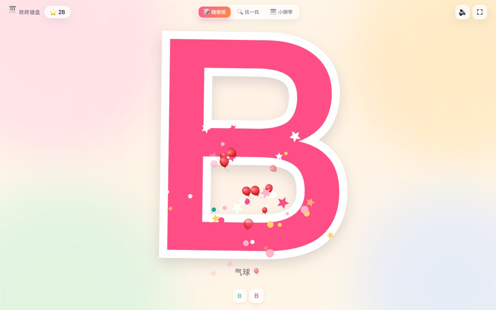

# 咚咚键盘 🎹

给小朋友随便敲键盘玩的静态小游戏。按哪个键，屏幕上就蹦出一个**大大的字**，配星星、彩纸和一声好听的「咚」。



## 开始玩

- **双击 `index.html`** 就能玩——不用安装、不用联网、不用构建。
- 也可以整个文件夹丢到任意静态服务器 / GitHub Pages / 内网共享目录。
- 点「开始玩」会尝试进入全屏（`Esc` 退出），右上角也有全屏按钮。

## 三种玩法

### 🎲 随便按

按任意键 → 全屏巨字 + 糖果色描边 + 星星爆开 + 木琴音。
空格、回车、退格、方向键、Shift、F1–F12 这些特殊键也有中文名字和小表情。
屏幕底部会留下最近按过的 8 个键。

### 🔍 找一找

小兔子说「找一找 B」，按对了撒彩纸、+5 颗星；按错了只有一句温柔的提示，**不扣分、不结束**。
题库去掉了容易看混的 `I`、`O`、`0`、`1`；每题 7 秒没动静，气泡会轻轻晃一下提醒。

### 🎹 小钢琴

每个键对应五声音阶里的一个音，**物理上相邻的键，音高也相邻**，所以随便乱按都好听。
每按一下会扩散一圈彩色涟漪。

## 给家长的小提示

- 需要实体键盘；手机 / 平板上打不开输入，只能看到界面。
- 右上角 🔊 静音、⛶ 全屏；声音开关会记住上次的选择。
- 星星存在浏览器本地（`localStorage`），关掉再打开还在。想清零：控制台执行
  `localStorage.removeItem('dongdong.stars')`。
- 网页会拦截空格、方向键、Tab、退格、F1–F10 的默认行为，避免误滚动、误跳转。
- 但 `Cmd+W` / `Ctrl+W` / `Cmd+Q` 这类浏览器和系统快捷键，任何网页都拦不住。
- 中文输入法开着也能识别字母：`e.key` 不可靠时会退回物理键位 `e.code`。
- 全屏时按 `Esc` 会先退出全屏，这是浏览器的行为。

## 文件结构

```
keyboard-kids/
├── index.html
├── preview.jpg
├── css/
│   └── style.css      # 布局、糖果配色、动画
├── js/
│   ├── keymap.js      # 键位 → 字 / 词 / 音高 / 题库
│   ├── audio.js       # Web Audio 现场合成音效
│   ├── fx.js          # Canvas 星星、彩纸、光圈
│   └── app.js         # 三种玩法与界面逻辑
└── README.md
```

零依赖、零构建、零外部请求；字体用系统自带的圆体。

## 想改点什么

| 想改 | 去哪 |
| --- | --- |
| 字母配的词和 emoji | `js/keymap.js` 的 `LETTER_WORDS` / `DIGIT_WORDS` |
| 主题配色 | `css/style.css` 的 `:root` + `js/app.js` 的 `COLORS`（两边一起改） |
| 「找一找」题库 | `js/keymap.js` 的 `FIND_POOL` |
| 星星奖励多少 | `js/app.js` 里 `addStars(...)` 的调用处 |
| 音色 | `js/audio.js` 的 `pop()` / `piano()` |
| 大字占屏幕的比例 | `js/app.js` 的 `fit()` 里 `* 0.99` 和 `css/style.css` 的 `.glyph` 行高 |

## 技术说明

- 单页纯静态，`file://` 直接打开可用：脚本都是普通 `<script>`，没有 ES Module（避免本地打开被 CORS 拦）。
- 音效全部由 Web Audio 现场合成，工程里没有任何音频文件；音高取自五声音阶，所以乱按也和谐。
- 键盘事件优先读 `e.key`（跟随键盘布局），拿不到时退回 `e.code`（物理键位），并过滤长按产生的 `repeat`。
- 巨字用 JS 测量后自适应，横屏、竖屏、超宽屏、投影仪都不会溢出；窗口缩放会重新排。
- 粒子用一个 canvas + 单个 rAF，粒子落完自动停，不空转。
- 支持 `prefers-reduced-motion`（减少动态效果）。

## 调试

`index.html?demo=1&key=B`：跳过开始页直接进游戏并模拟按下 B，且不请求全屏。
其他例子：`?demo=1&mode=find`、`?demo=1&mode=piano&key=G`、`?demo=1&code=Space`。

## 浏览器

Chrome / Edge / Safari / Firefox 近两年的版本。
